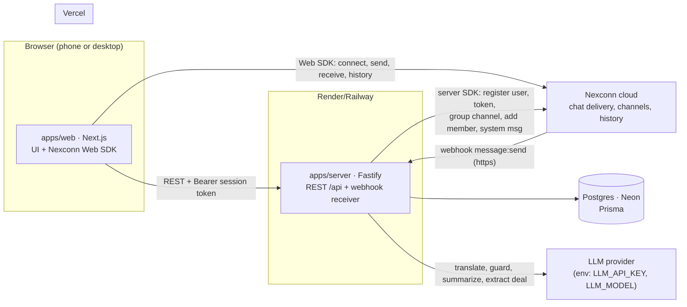
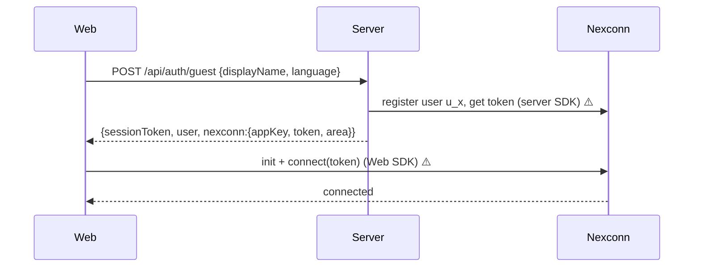
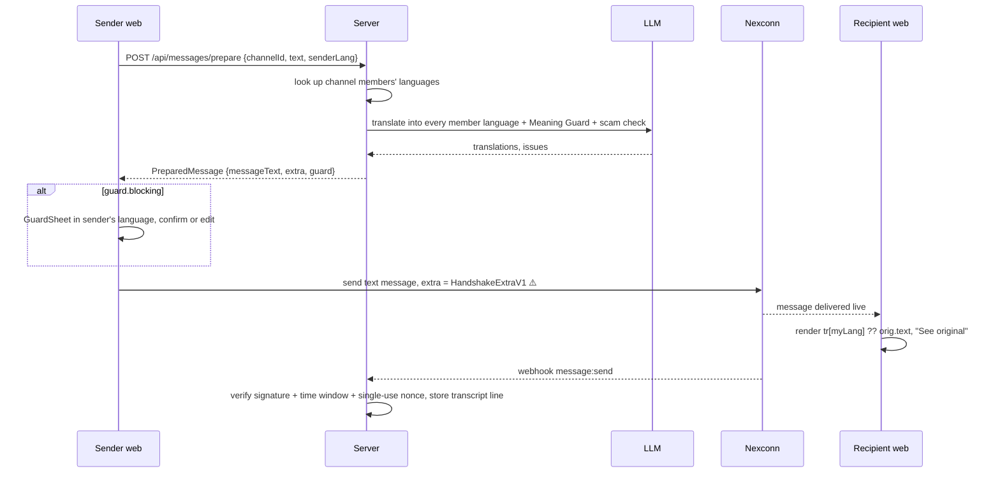

# Architecture — how Handshake fits together

Owner: **humans only**. Agents propose changes with a `DECISION` message. Interfaces live in `CONTRACTS.md` (Akshat); this file explains how the pieces connect and why.
Anything that depends on Nexconn behavior nobody has tested is marked ⚠️ **UNVERIFIED** — it mirrors the `UNVERIFIED` sections of CONTRACTS and is resolved by AKSHAT-T02 / DHRUMIL-T02.

---

## 1. System at a glance



**Two paths, on purpose:**
- **Chat messages** travel browser → Nexconn → browser. Our server is never in the delivery path, so chat stays live even if the server is slow.
- **Intelligence and state** (translation, Meaning Guard, listings, cases) go through our server, which is the only place secrets and the LLM live.

| Component | Owner | Tech | Deployed on |
|---|---|---|---|
| Web app | Dhrumil | Next.js App Router, TypeScript, Tailwind, `@nexconn/engine` + `@nexconn/chat` | Vercel |
| API server | Akshat | Node, Fastify, TypeScript, Nexconn Node server SDK, Prisma | Render or Railway |
| Shared contracts | Akshat | TypeScript + zod in `packages/contracts` | imported by both |
| Database | Akshat | Postgres (Neon free tier) | Neon |
| Chat infrastructure | Nexconn | One production app (D-008) | Nexconn cloud |
| LLM | Akshat | Provider chosen by env (D-005) | external API |

---

## 2. Repository layout

```
apps/
  web/                      Dhrumil
    src/app/                routes: /, /onboarding, /listings, /listings/[id], /chats, /chats/[id],
                            /cases/[id], /agent, /agent/cases/[id], /try
    src/lib/nexconn/        THE ONLY place that imports @nexconn/* (connect, send, listeners, history)
    src/lib/api/            typed fetch client for /api, using packages/contracts
    src/mocks/              contract-shaped mocks, each marked // MOCK: remove when AKSHAT-T0x lands
    src/components/         MessageBubble (C4 render rule), GuardSheet, DealCard, ScamBanner, ...
  server/                   Akshat
    src/routes/             auth, me, listings, chats, messages, deals, cases, agent, demo, webhooks
    src/nexconn/            THE ONLY place that imports the Nexconn server SDK
    src/llm/                translate, guard, scam, summarize, extractDeal — one provider adapter
    src/db/                 Prisma schema + client
packages/
  contracts/                Akshat — every type in CONTRACTS.md, as TS + zod
scripts/                    Akshat — seed.ts, smoke.ts (pnpm smoke)
infra/                      Akshat — deploy config
docs/                       Dhrumil — write-up, demo script, AI_USAGE.md, screenshots
```

Isolation rule: if the Nexconn SDK surprises us, or we pivot to Chat UI (D-012), only `apps/web/src/lib/nexconn/` and `apps/server/src/nexconn/` change.

---

## 3. Identity

- **Our user id = Nexconn user id** (`u_<nanoid>`, `demo_u_…`). ⚠️ UNVERIFIED that Nexconn accepts our ids as-is (C2).
- **Session token:** random opaque token, stored hashed in `sessions`, sent as `Authorization: Bearer`. Signed with `SESSION_SECRET`. Stored in `localStorage` on the web so refresh keeps you signed in; `/api/me` re-issues the Nexconn token.
- **Nexconn token:** issued by the server SDK at sign-in, returned with the App Key and area. The browser never sees the App Secret.
- **Roles:** `user` (buys and sells) and `agent`. Agents sign in through `POST /api/auth/agent` with a shared `AGENT_ACCESS_CODE` from server env (D-017). Only the two of us know the code.



---

## 4. Core flows

### 4.1 Open a chat (Golden Path step 3)
1. Buyer taps **Chat with seller** → `POST /api/chats {listingId}`.
2. Server returns the existing chat for (buyer, listing) or creates a row; `channelId` is a **direct** channel between buyer and seller. ⚠️ UNVERIFIED whether a direct channel must be created server-side or exists implicitly once one side sends.
3. Web opens the channel, loads history from Nexconn, and renders it.

### 4.2 Send and read a message (the heart of the product)



- Translation happens **before send** (D-007), into the language of **every member** of the channel (2 for a direct chat, up to 3 in a case group).
- **Degrade, never block:** if the LLM fails or exceeds its time budget, `/prepare` returns `tr: {}` and the original text, and the web sends anyway. The recipient sees the original with a "Translation unavailable" note. Chat never stops working.
- **Render rule (C4):** unknown or missing `extra` → plain text body. The web never crashes on a foreign message.
- ⚠️ UNVERIFIED: the `extra` field name and size limit. If it's too small for translations in 3 languages, fall back to a custom message type or send only the recipient's language and let the server's transcript hold the rest.

### 4.3 Deal Card (Phase 2)
`POST /api/deals/extract {channelId}` → LLM reads the recent transcript and proposes a `Deal` → posted as a `deal_card` message → each side taps **Agree** (endpoint added to C3 by AKSHAT-T12) → status `agreed`. The latest agreed deal is stored in `deals`.

### 4.4 Escalation: Get help → agent → resolved (Golden Path steps 4–5)

```mermaid
sequenceDiagram
  participant U as Buyer or seller
  participant S as Server
  participant N as Nexconn
  participant A as Agent console
  U->>S: POST /api/cases {channelId, reason, note}
  S->>S: create case, snapshot latest agreed Deal (frozen), set slaDueAt
  S->>N: create group channel {buyer, seller} ⚠️
  S->>N: post system/case_opened (all languages) ⚠️
  S-->>U: {case}, UI shows "An agent is on the way"
  loop every 5 s (D-011)
    A->>S: GET /api/agent/queue
  end
  A->>S: POST /api/cases/:id/claim
  S->>N: add agent to group ⚠️, post system/case_claimed
  A->>S: GET /api/cases/:id
  S-->>A: case + bilingual transcript + AI summary in agent's language + frozen deal
  A->>N: chat in the 3-way group (Web SDK; agent's messages go through /prepare too)
  A->>S: POST /api/cases/:id/resolve {resolution}
  S->>N: post system/case_resolved
```

- **Routing v0:** prefer an agent whose `agentLanguages` cover both parties; among them, fewest open claimed cases; otherwise any agent. The queue shows every open case to every agent — routing only sorts it.
- **Transcript:** built from the webhook store. If the agent's language isn't among the stored translations, the server translates on read and caches the result.
- **Claim race:** `claim` is a single conditional update (`status = open → claimed`); the loser gets `409`.

### 4.5 Scam shield (Phase 2)
Two checks: in `/prepare` (sender sees a warning before sending) and in the webhook (catches messages that skipped `/prepare`). On a hit, the server posts `system/scam_warning` into the channel. ⚠️ UNVERIFIED: server-side message send.

### 4.5a USP features (D-020 to D-027)
- **Three languages, one room (D-021):** `/prepare` looks up every member of the channel and translates into each language. In a case group that's buyer + seller + agent. Agents get the summary in their language too.
- **Show me what they saw (D-022):** when the server stores a transcript line, it computes `shownTo` per member by applying the C4 render rule (`tr[memberLang] ?? orig.text`, `translated` = whether a translation existed). Same rule as the client, so it's exactly what each screen showed. The agent console toggles between "in my language" and "what each side saw".
- **Handshake Seal (D-023):** when the second side agrees, the server sets a random unguessable `sealCode` (e.g. 12+ url-safe chars) on the deal. `/seal/<code>` is a public web page that calls `GET /api/seals/:code` and shows the deal in the viewer's language with a QR code of its own URL. Verification = the lookup succeeds on our domain. No buyer/seller ids or contact details are exposed, only display names.
- **Tone Guard (D-024):** same LLM call as Meaning Guard; returns `kind: "tone"` issues with a softer suggestion. Never blocking.
- **WhatsApp-group launcher (D-025):** listing pages are public. Share button uses the native share sheet / `wa.me` link with the listing URL. A visitor without a session gets the name + language sheet, then lands back on the listing.
- **Kept-deal score (D-026):** computed on read from `deals` and `cases`; no new table.
- **Voice notes (D-027, stretch):** only after the SDK spike confirms voice messages. Not designed further until then.

### 4.6 Judge sandbox (Phase 3)
`/try` → **Try as buyer / seller / agent** → `POST /api/demo/session {as}` signs in as one of a **fixed set of `demo_` users** with seeded listings, the scripted "2 lakh" conversation and an open case. The sandbox **never creates a new Nexconn user per click** (D-015), so it can't inflate the active-user count judges look at.

---

## 5. Data model (Postgres, Prisma)

| Table | Key columns | Notes |
|---|---|---|
| `users` | `id`, `displayName`, `language`, `role`, `isDemo`, `agentLanguages[]` | `id` = Nexconn user id |
| `sessions` | `tokenHash`, `userId`, `createdAt`, `expiresAt` | |
| `listings` | `id`, `sellerId`, `title`, `description`, `lang`, `price` (amount, currency), `imageUrl` | stored in the author's language |
| `listing_translations` | `listingId`, `lang`, `title`, `description` | cache for translated reads |
| `chats` | `channelId`, `listingId`, `buyerId`, `sellerId`, `createdAt` | unique (`buyerId`, `listingId`) → idempotent |
| `deals` | `id`, `channelId`, `listingId`, `payload` (Deal JSON), `status`, `agreedBy`, `sealCode` (unique, nullable) | `sealCode` set when both agreed (D-023) |
| `cases` | `id`, `channelId`, `groupChannelId`, `buyerId`, `sellerId`, `agentId`, `reason`, `status`, `dealSnapshot` (Deal JSON), timestamps, `slaDueAt`, `resolution` | `dealSnapshot` is frozen when the case opens |
| `transcript_lines` | `nexconnMessageId` (unique), `channelId`, `at`, `fromId`, `origLang`, `origText`, `tr` (JSON), `shownTo` (JSON, D-022) | unique id de-duplicates webhook retries and the local-dev relay |
| `webhook_nonces` | `nonce` (unique), `receivedAt` | single-use nonces; prune older than the time window |

Traction export (AKSHAT-T14) = counts from these tables **where `isDemo = false`**.

---

## 6. Security

- **Secrets** (`NEXCONN_APP_SECRET`, `DATABASE_URL`, `LLM_API_KEY`, `SESSION_SECRET`, `AGENT_ACCESS_CODE`) exist only in server env. Never in `apps/web`, git, logs, responses or coord messages.
- **The browser receives only** the App Key, the area, its own Nexconn token and its own session token.
- **Webhook:** `https://` only; verify the signature, reject outside the time window, reject a reused nonce. The signature does **not** cover the body (Primer §5), so the server never trusts message content from the webhook for anything but transcript and scam checks.
- **Authorization:** every `/api/agent/*` and `/api/cases/:id/{claim,resolve}` route checks `role = agent`. `GET /api/cases/:id` is allowed for the case's buyer, seller or any agent.
- **CORS:** only `WEB_ORIGIN`.
- **Errors** use the C1 shape; no stack traces in responses.

---

## 7. Failure handling (the "no blank screens" rule)

| Failure | What the user sees | Mechanism |
|---|---|---|
| Nexconn disconnects | "Reconnecting…" bar; composer disabled | SDK connection-status listener ⚠️ event names to verify (DHRUMIL-T02) |
| Page refresh | Same screen, history reloaded | session in localStorage → `/api/me` → reconnect → history from Nexconn |
| LLM slow or down | Message sends in original; "Translation unavailable" note | `/prepare` time budget, returns `tr: {}` + `retryable` |
| Server down | Friendly error with **Try again**; existing chats still deliver | chat path doesn't depend on the server |
| Unknown message format | Plain text body | C4 render rule |
| Claim lost to another agent | "Another agent took this case" | `409` from claim |
| Empty lists | Empty state with a next action ("Post your first listing") | every list screen |

---

## 8. Deployment and environments

| Env | Web | Server | Nexconn app | DB |
|---|---|---|---|---|
| Local | `pnpm --filter web dev` | `pnpm --filter server dev` | production app, with test users only | Neon dev branch |
| Production | Vercel (`main`) | Render/Railway (`main`) | **the one production app** (D-008) | Neon main |

- Webhooks can't reach localhost: use a tunnel, or let the web relay received messages to the server in local dev only, de-duplicated on `nexconnMessageId`.
- Env vars: CONTRACTS C8 (+ `AGENT_ACCESS_CODE`, D-017).
- **Merge gate:** `pnpm smoke` (AKSHAT-T09) runs the Golden Path against the deployed server before anything merges to `main`.

---

## 9. Open questions (resolved by the spikes)

| # | Question | Resolved by | If the answer is no |
|---|---|---|---|
| 1 | Does Nexconn accept our own user ids? | AKSHAT-T02 | keep a `nexconnUserId` column on `users` |
| 2 | Does a text message have `extra`? Size limit? | AKSHAT-T02 | custom message type, or only the recipient's language in the message |
| 3 | Can the server create a group channel and add members? | AKSHAT-T02 | the case's buyer creates the group from the web SDK; server adds the agent |
| 4 | Can the server send a system message into a channel? | AKSHAT-T02 | system events rendered from `/api/cases/:id` state instead of messages |
| 5 | Must direct channels be created server-side? | AKSHAT-T02 / DHRUMIL-T02 | web creates on first send |
| 6 | Two browsers chat live via the Web SDK by Nov 4? | DHRUMIL-T02 | pivot to Chat UI components (D-012) |
| 7 | Does the Web SDK support voice messages? | DHRUMIL-T02 | voice notes cut (D-027) |
| 8 | Is `extra` big enough for 3 translations (case groups)? | AKSHAT-T02 | only the recipient languages that fit; server transcript holds the rest |
