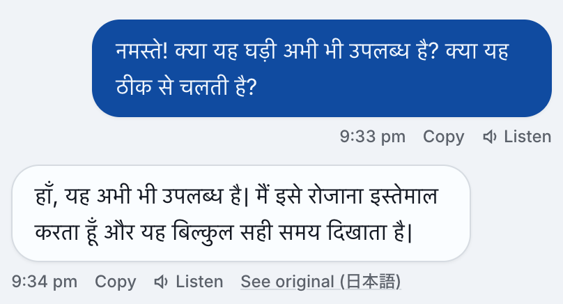
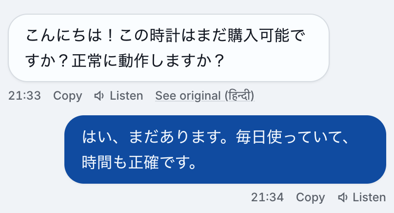
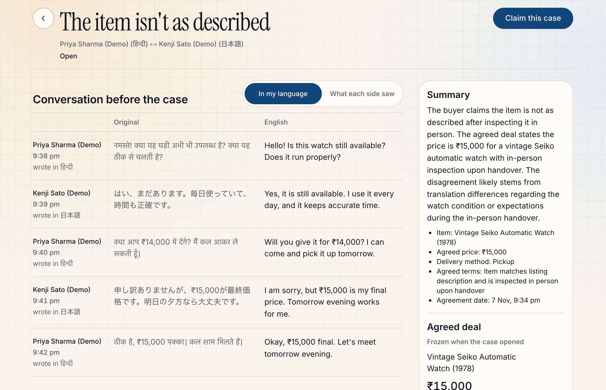

# CommonGrounds

**Same deal, in both languages.**

Nexconn Build Challenge 2026 · Track: Marketplace & Support · Team: Dhrumil (experience) and Akshat (platform)

| | |
|---|---|
| Live app | https://arctic-swart-six.vercel.app |
| Try it in one click | https://arctic-swart-six.vercel.app/try |
| Source code | https://github.com/Akshat14z/Arctic |
| Nexconn App Key | `tdrvipkstz5v5` |

## The problem: translation creates disputes

Cross-language marketplaces are not a niche. India alone trades across 22 scheduled languages: a Tamil-speaking seller and a Hindi-speaking buyer meet on the same college resale group every day. Machine translation gets their words across, but not always their deal. "2 lakh" can arrive as 200,000, as "2 lakh" or as 200. "Almost new" becomes "new". Each side walks away believing they agreed to something different, and when it goes wrong, a support agent has to reconstruct who said what, in which language.

Every competitor translates words. **CommonGrounds guarantees shared meaning**, and proves it.

## What we built

CommonGrounds is a working marketplace with a 1:1 buyer-seller chat, a human support dispatch center and translated chat, the three track requirements, joined into one chain of trust:

1. **Every message, in your language.** Each side writes in their own language and reads the other in theirs. **See original** shows exactly what was typed; **Listen** reads it aloud in the reader's language. The interface itself (chat, deals, help, navigation, listings) follows the reader in Hindi, Japanese or English.
2. **Meaning Guard, before you send.** Risky content is caught before it leaves: "I can pay 2 lakh" is held, and the sender is offered **₹2,00,000** so both sides see the same number. Tone Guard offers a softer version of a curt message; off-platform payment requests trigger a scam warning.
3. **One deal, two languages.** An offer becomes a **Deal Card**: the same item, price and terms on both screens, each in its reader's language, agreed by both.
4. **The CommonGrounds Seal.** An agreed deal becomes a QR receipt whose link carries an **Ed25519 signature**. Scanning it, the page verifies the signature on the scanner's own phone: "Signed by CommonGrounds". A changed price is flagged in red. It still verifies if our server is down.
5. **Help that reads both sides.** Tap **Get help** and a case reaches the dispatch console. The agent sees an **AI summary** (the claim set against the agreed terms), the **Deal Card frozen** when help was requested, and **What each side saw**: the exact text each person had on screen, in each language. Buyer, seller and agent then talk in one room, each reading their own language. The agent needs to speak neither.
6. **A seller's workspace.** A seller dashboard, public storefronts, following sellers, a watchlist and WhatsApp sharing bring buyers from where they already trade.

## Nexconn SDK: where and how we use it

**Chat SDK (web, `@nexconn/chat` and `@nexconn/engine` 26.2.1)**

- **Engine and connection:** `NCEngine.initialize` and `connect` with a per-user token from our server; connection-status handlers drive the reconnecting state.
- **Group channels:** one per buyer and listing, so two listings with the same seller never share a conversation; a separate group channel per support case for the 3-way room.
- **Text messages with a structured `extra` payload:** each message carries the original text, every translation, Meaning Guard results, Deal Cards and voice-note audio. One message, many readers, each sees their own language.
- **Live delivery and history:** message handlers for real time; `createMessagesQuery` restores the conversation after a refresh.

**Server SDK (`@nexconn/server-sdk`)**

- `issueAccessToken` for every user: guests, accounts, demo accounts and agents.
- `createGroupChannel`, `joinGroupChannel` and `batchGetGroupChannelProfiles` for chat rooms and the support room; the agent joins on claim.
- `sendGroupChannelMessage` for server-sent messages.
- **Webhooks** with signature verification, anti-replay time windows and single-use nonces, recording every message for the agent's evidence view.

**Call SDK (optional, `@nexconn/call` 26.2.1):** 1:1 voice calls from the chat header, with incoming-call ringing on any page.

## Why this is new

- **Meaning, not just words.** Support tools translate the customer-to-agent conversation. Our agent gets the original buyer-seller conversation in both languages, plus what each side actually saw, plus the frozen deal.
- **A receipt anyone can verify.** The Seal turns a chat agreement into evidence that survives screenshots, edits and even our own downtime.
- **Prevention before resolution.** Meaning Guard stops the most expensive misunderstanding, a wrong number, before it is ever sent.

## Business and growth

- **Revenue:** a small fee per Deal Card both sides agree to (we never touch payment, so "agreed" is what we measure), and a paid seller plan (storefront, priority support, more listings).
- **B2B:** Meaning Guard, the Seal and the dispatch console as a plug-in layer for existing marketplaces built on Nexconn.
- **Go to market:** college and hostel buy-and-sell communities, where students from many states trade daily, then small local sellers we onboard personally. The WhatsApp share link opens a listing in the visitor's own language, one tap from a chat.
- **Traction today, honestly:** the app is live and open to anyone. At submission our production Nexconn app has a small number of real users beyond our team and the three labelled demo accounts; we report exact numbers in the submission form and never create accounts to inflate them.

## Built during the challenge

Everything in this repository was designed and built during the Nexconn Build Challenge 2026: there is no prior work. We used AI coding assistants throughout (documented in `docs/AI_USAGE.md` in the repository).

## Try it

Open https://arctic-swart-six.vercel.app/try and tap **Watch both sides at once**: Priya (Hindi) and Kenji (Japanese) side by side, live. Type as Priya and watch Kenji read it in Japanese. Scan the Seal on the Deal Card with a phone. Then open the agent console as Sarah and see what each side saw.

**Same deal, in both languages.**
