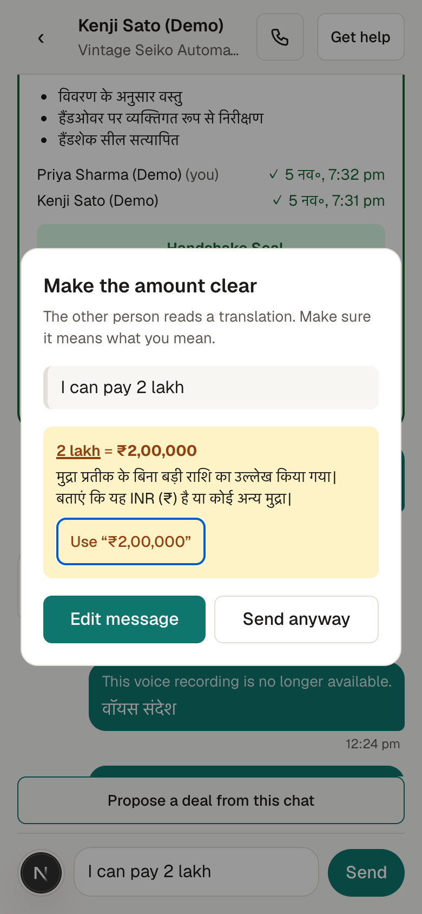
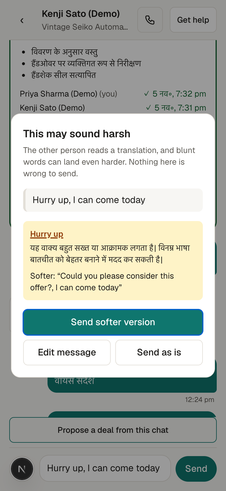
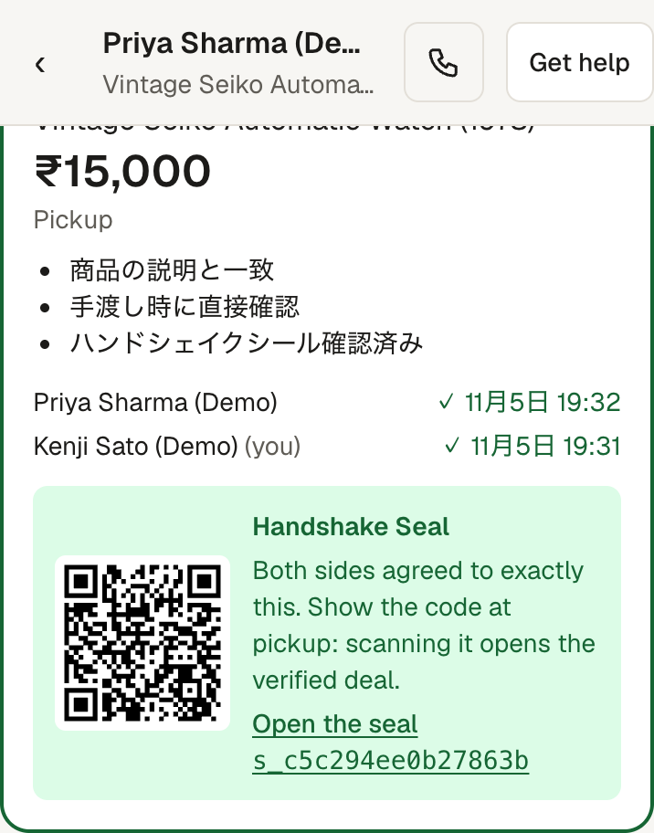
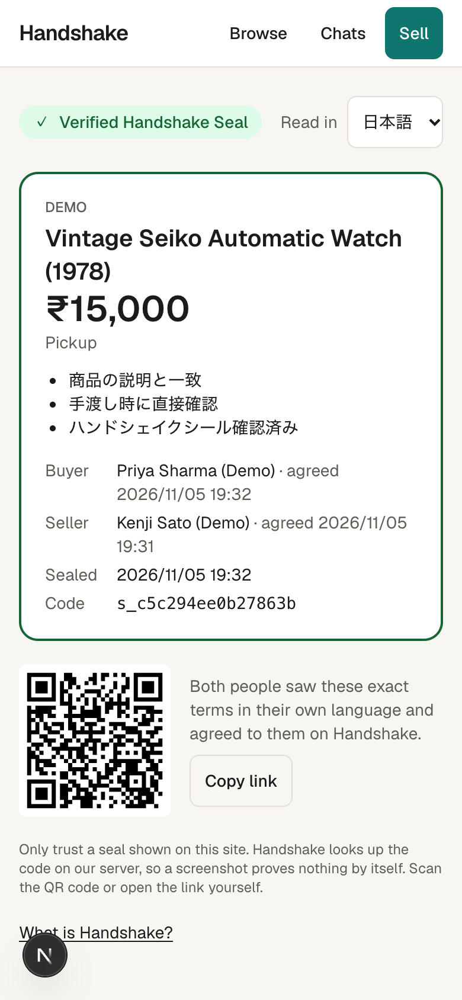
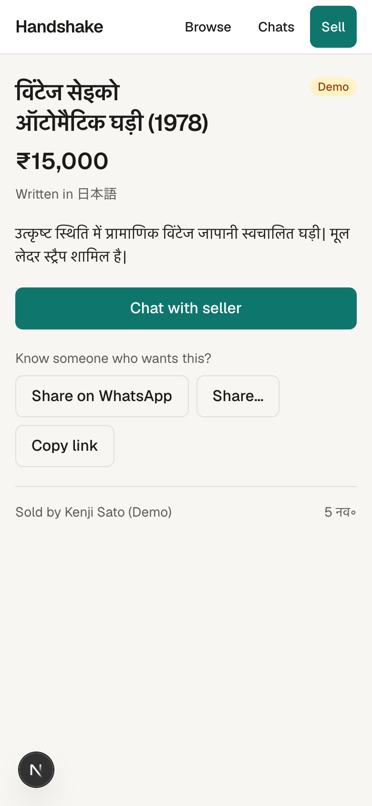

# Handshake — write-up (draft)

> **Draft for the humans.** This becomes the submission PDF. Items marked **⟦TO FILL⟧** need facts we don't have yet. Screenshots in `docs/screenshots/` are from local development before the visual redesign: retake them on the deployed app before export.

**Same deal, in both languages.**
Nexconn Build Challenge 2026 · Track: **Marketplace & Support**
Team: Dhrumil (experience) · Akshat (platform)

| | |
|---|---|
| Live app | ⟦TO FILL: deployed URL⟧ |
| Demo video | ⟦TO FILL: video link⟧ |
| Source code | https://github.com/Akshat14z/Arctic |
| Nexconn App Key | ⟦TO FILL: production App Key (also in the submission form)⟧ |

---

## 1. It works

Handshake is a marketplace chat for a buyer and a seller who don't share a language. Every message is translated so each side reads their own language, with the original one tap away. A human support agent can step in at any time.

### The full flow (all three track requirements)

1. **Sign in in seconds.** Guest sign-in: a name and a language, no forms, no password. Eight languages: English, Hindi, Tamil, Telugu, Kannada, Bengali, Marathi and Japanese.
2. **Post or browse listings.** Listings show in the reader's language, labelled with the language they were written in.
3. **1:1 buyer–seller chat, translated** *(track: buyer–seller 1-on-1 chat + multi-language translated chat).* Each side writes in their own language and reads the other's in theirs. **See original** shows exactly what was typed. History survives a refresh, and the chat shows a clear state while reconnecting.
4. **Get help** *(track: human agent dispatch center).* Either party opens a case from the chat. It appears in the agent console queue.
5. **The agent resolves it in a 3-way chat.** The agent sees the conversation in both languages, a case summary, the deal both sides agreed to (frozen when the case opened), and **what each side actually saw on screen**. Buyer, seller and agent then talk in one group chat, each reading their own language, and the agent marks the case resolved.

### What happens inside the chat

- **Meaning Guard.** Before a message with an ambiguous amount is sent, the sender sees what the other side would read and can fix it in one tap: "I can pay 2 lakh" → **₹2,00,000**.
  
- **Scam warning.** Moving the chat off the platform ("let's continue on WhatsApp", "call me on +91…") or paying outside it (gift cards, crypto, wire transfer) warns the sender first. If they send anyway, the reader sees a warning too.
- **Tone Guard.** "Hurry up" may read harsher in translation. The sender can send a softer version or send it as is. Never blocking.
  
- **Deal Card → Handshake Seal.** One tap turns the negotiation into structured terms (item, price, delivery, conditions). Both sides see the same card in their own language and agree. Once both agree it becomes a **Handshake Seal**: a code and a QR that opens a public page anyone can check, for example at pickup.
   
- **Voice notes.** Record up to 60 seconds. The server transcribes it, and the transcript is translated and checked like typed text. The reader can play the original audio.
- **Voice calls.** 1:1 audio calls from the chat header, using the Nexconn Call SDK. The call screen reminds both sides that voice isn't translated, so prices and terms belong in the chat. ⟦TO FILL: confirm calls connect once Call/VoIP is enabled for our App Key⟧
- **Share on WhatsApp.** Sellers post a listing link to the groups where their buyers already are. The link shows a preview card, opens in the visitor's language, and leads to the chat after a guest sign-in.
  

### How to try it

⟦TO FILL: live link⟧ → sign in as a guest, or use the one-click demo accounts (labelled "Demo"): Priya reads Hindi, Kenji reads Japanese, Sarah is the support agent. ⟦TO FILL: link to the one-click sandbox once it ships with the landing page⟧

### Reliability and polish

- **Chat never stalls on AI.** Translation runs on our server under a time budget. If it is slow, the original is sent, and the reader still gets the message.
- **Every failure has a friendly state.** Loading, empty, offline, reconnecting, not found and permission states are all handled; no blank screens or raw errors.
- **Mobile-first.** Built and tested at phone width, with 44 px tap targets.
- **Tested end to end.** An automated Golden Path test (`pnpm smoke`) covers sign-in, listing, chat, message preparation, the Nexconn webhook, deal and seal, and case escalation to resolution. Server, contract and web unit tests run alongside it. We also tested every feature live with two browsers at once, against the production Nexconn app.

### Features that use the Nexconn SDK

**Nexconn Web SDK** (`@nexconn/chat`, `@nexconn/engine` 26.2.1)
1. **Engine connection** with a per-user token from our server, with connection-status handling (reconnecting state, sign-out on an invalid token).
2. **Direct channels** for the 1:1 buyer–seller chat.
3. **Group channels** for the 3-way case chat between buyer, seller and agent.
4. **Text messages with a structured `extra` payload** that carries the original text, every translation, Meaning Guard results, Deal Cards and voice-note audio links. One Nexconn message carries everything both sides need.
5. **Real-time delivery** through message handlers, and **message history** when a chat is reopened.

**Nexconn Call SDK** (`@nexconn/call` 26.2.1)
6. **1:1 audio calls** between buyer and seller, with incoming-call ringing on any page, mute and hang-up.

**Nexconn Server SDK** (`@nexconn/server-sdk` 0.1.2)
7. **User tokens** issued per signed-in user (User Management API).
8. **Group channel creation** for each support case, and **adding the agent** as a member (Group Channel Management API).
9. **`message:send` webhook** with signature verification and replay protection. It records which language each participant was shown, which powers the agent's "what each side saw" view.

The Nexconn App Secret stays on our server; the browser only ever gets the App Key and a per-user token.

### What existed before the challenge

**Everything in this repository was built during the challenge (Oct 23 – Nov 22, 2026).** No code, design or data existed before it. We built it with AI coding assistants and document how in `docs/AI_USAGE.md`.

---

## 2. Problem and idea

### The problem: translation creates disputes

Translated chat is already common in marketplaces. Alibaba translates buyer–seller messages; eBay and Etsy translate listings. But translation helps people *talk*. It doesn't make sure they *agree to the same thing*.

When a buyer and a seller negotiate through translation, the risky parts are exactly the ones that matter: amounts, units and conditions. "₹2 lakh" is a normal Indian amount that a reader in another language may not understand, or a system may render inconsistently. Research shows that translation systems make mistakes with numbers¹. When the two sides walk away believing different things, a support agent has to work out who said what, in which language, and usually can't read one side's.

India alone is this market. It has 22 scheduled languages, so a Tamil-speaking seller and a Hindi-speaking buyer face this without leaving the country.

### The idea: make the chat itself the trust layer

Handshake guarantees **shared meaning**, not just translated words, in one chain:

| Stage | Feature | Promise |
|---|---|---|
| Before sending | Meaning Guard + Tone Guard | What you say is what they read, and how you meant it |
| Agreeing | Deal Card → Handshake Seal | What you agreed is written down, and anyone can verify it |
| When it goes wrong | Three languages, one room | Disputes are settled on evidence, by an agent who doesn't need to speak either language |
| Growth | WhatsApp-group launcher | Paste a link where your buyers already are |

### Why it's new

- **Marketplace translation** (Alibaba, eBay, Etsy) translates words. None of them checks meaning before sending, records agreed terms in both languages, or keeps evidence for disputes.
- **Support translation tools** (for example Unbabel inside Zendesk or Intercom) translate the *customer ↔ agent* conversation. Our agent gets the *original buyer–seller* conversation in both languages, plus the frozen Deal Card and what each side saw.
- **Indian language platforms** (Bhashini, Sarvam, multilingual shopping apps) translate screens, voice bots and support. None translates the conversation *between* a buyer and a seller.
- **Scam research** agrees that moving the deal off-platform is the main sign of a purchase scam². Handshake catches it in the chat, before the message is sent.

¹ Behavioural testing of commercial translation systems on numbers (2021), arXiv:2107.08357; numerical translation with LLMs (2025), arXiv:2501.04927. We don't claim an error rate for lakh/crore amounts specifically: we haven't measured one, so Meaning Guard is presented as *clarity*: both sides always see the same exact amount.
² Sardine, *Off-platform payment abuse*.

---

## 3. Traction and business

### Real users on Nexconn

⟦TO FILL after launch (Nov 10): active users on our Nexconn app (console screenshot), real listings, chats, deals agreed, cases opened and resolved, and a few user quotes (with permission).⟧

**How we count, honestly:** demo accounts and listings have ids starting with `demo_` and are labelled "Demo" in the app. The judge sandbox reuses a small fixed set of them and never creates new Nexconn users. Every number above excludes `demo_` users. Automated tests mock Nexconn, so they never register users on our app.

**Where users come from:** ⟦TO FILL: beachhead confirmed by H-04, e.g. college and hostel buy/sell groups with students from many states, and local sellers we onboard personally⟧. The **WhatsApp-group launcher** is the growth loop: a seller pastes a listing link into a group; each visitor opens it in their own language, signs in as a guest in seconds and is one tap from chat.

### Business model

- **A small fee per Deal Card both sides agree to.** We never handle payment, so an agreed deal is the unit we can measure and charge for.
- **A paid seller plan:** verified badge, priority support, more listings.
- **B2B:** license Meaning Guard, Deal Cards and the dispatch console as a layer for existing marketplaces built on Nexconn.

### Path to a product

⟦TO FILL with the humans: next 3 steps after the challenge, e.g. pilot with one campus marketplace, payment-provider integration for sealed deals, more Indian languages⟧
